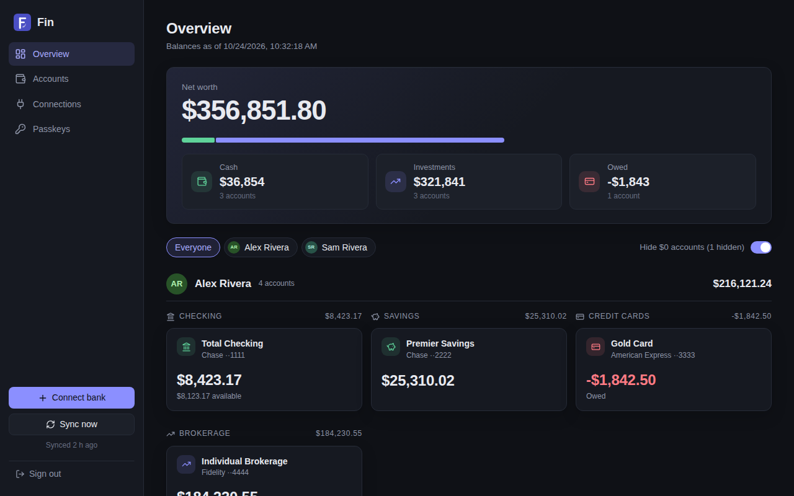
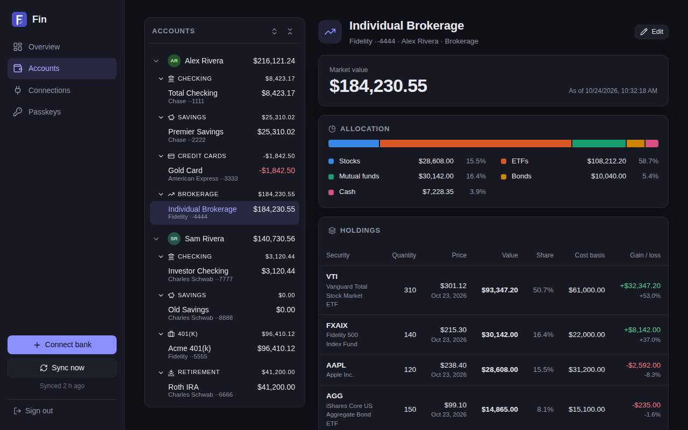
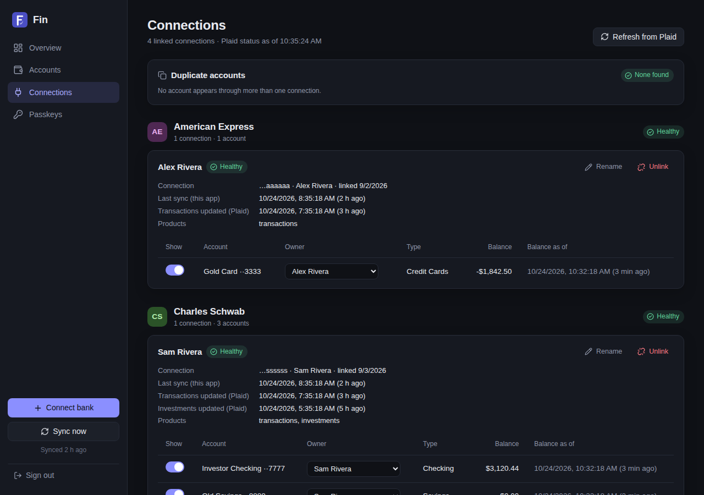

# Fin

A small, read-only dashboard of account balances and transactions across a family's banks, backed by [Plaid](https://plaid.com).
A daily sync pulls balances and transactions; brokerage and retirement accounts show their current value, an allocation by asset class, and a holdings table (positions, price, cost basis, gain/loss) instead of a register, except cash management accounts (automatic for Plaid's `cash management` subtype, or switched on per account under Edit), whose activity comes from Plaid Investments. Each sync also records a daily snapshot of every balance and position, for value-over-time charts later.

## Screenshots
Sample data only.

**Overview**



**Accounts**



**Connections**



## Pages
Every signed-in page shares one frame: a sidebar with the pages, **Connect bank**, **Sync now** and sign out (a top bar and bottom tabs on phones).

| URL | What it shows |
|---|---|
| `/` | Overview: net worth, cash / investments / owed, and a card per account grouped by owner and type |
| `/accounts` | Account list (owners → account types → accounts) beside the selected account: balance, holdings and allocation for investment accounts, and a searchable, lazily-loaded transaction register |
| `/connections` | Linked banks grouped by institution: health, last sync, per-account owner and show/hide, duplicate detection, rename and unlink |
| `/passkeys` | The passkeys that can sign in: add one on this device, make a one-time invite link for another device, remove one, sign out |
| `/login` | Sign in with a passkey (or create the first one) |

Each account's owner is set by hand (the Owner menu on Connections, or **Edit** on the account); until then it is listed under
"Unassigned". Accounts are grouped by type automatically (overridable under **Edit**).
Credit cards and loans are shown as negative (owed) so totals add up.

## Configuration
Copy `.env.example` to `.env` and fill it in:

| Variable | Purpose |
|---|---|
| `PLAID_CLIENT_ID`, `PLAID_SECRET`, `PLAID_ENV` | Plaid credentials (`production` for real banks, `sandbox` for testing) |
| `PLAID_REDIRECT_URI` | Required for OAuth banks (Wells Fargo, Amex, Schwab, ...). Must be `https://<your-host>/accounts` and registered under *Allowed redirect URIs* in the Plaid Dashboard |
| `SYNC_CRON`, `TZ` | When the daily sync runs (default `0 6 * * *`) and in which timezone |
| `HOSTNAMES` | Hostname(s) Caddy serves the app on (compose labels) |
| `APP_ORIGIN` | Optional. The origin passkeys are bound to (e.g. `https://fin.example.com`); defaults to the address each request arrives on |
| `DATA_DIR`, `PORT` | Database directory (default `data`, `/data` in the container) and listen port |
| `DB_KEY` | Optional. 64 hex chars (`openssl rand -hex 32`): encrypts the database (an existing plaintext one is encrypted in place on the next start). Losing it loses the data |
| `OP_TOKEN_FILE` | Compose only: host path of the 1Password service-account token (default `/etc/op/token`) |

### Secrets from 1Password
In the container, any variable whose value is a 1Password secret reference (`op://vault/item/field`) is replaced at
startup by `fin-entrypoint.sh`, so `.env` on the server holds references instead of secrets. It reads them with a
service account that can only read one dedicated vault for the server (one item per app, fields named after the
variables they replace):
1. Create a vault for the server (e.g. `my-server`) holding an item `fin` with fields `PLAID_CLIENT_ID`,
   `PLAID_SECRET` and, if you encrypt the database, `DB_KEY` (in the 1Password app, so secrets stay out of shell history).
2. Create the service account and send its token straight to the server:
   ```
   op service-account create my-server --vault my-server:read_items --raw \
     | ssh <host> 'install -D -m 400 -o 1000 -g 1000 /dev/stdin /etc/op/token'
   ```
3. In the server's `.env`, set `PLAID_CLIENT_ID=op://my-server/fin/PLAID_CLIENT_ID`, `PLAID_SECRET=op://my-server/fin/PLAID_SECRET`
   and `DB_KEY=op://my-server/fin/DB_KEY`, as in `.env.example`.
The token file is owned by uid 1000 because the container runs as `node`. The token is printed only once; if it is
lost, create a new service account (and delete the old one in 1Password). Startup fails (after a 60 s pause, to stay
within 1Password's rate limits) if a reference can't be read. Without 1Password, put plain values in `.env` and set
`OP_TOKEN_FILE=/dev/null`.

## Run
```
docker compose up -d --build     # the app listens on 3000 inside the container
pnpm install && pnpm build       # build the web app into dist/web (the server serves it)
pnpm dev                         # local server (Node >= 22.9); pnpm dev:web alongside it for live reload on :5173
pnpm test                        # unit + API tests
pnpm typecheck
```
The compose file follows a Caddy-docker-proxy pattern: no published ports, and the container joins the external `apps` network
so Caddy can route to it from labels. Adjust `docker-compose.yml` if you front it differently.

The daily sync runs inside the server process, so run a single instance. **Sync now** in the sidebar forces one.

## Data and security
- State lives in SQLite at `$DATA_DIR/fin.db` (`./data`, bind-mounted, in compose), including Plaid access tokens. Set `DB_KEY` to encrypt it at rest (keep the key in 1Password, not next to the database), and back it up.
- Sign-in is by passkey. There are no user accounts: every passkey on `/passkeys` can see everything.
  - **First run:** until a passkey exists, whoever opens the app can create one, so do that right after deploying. After that, new passkeys need a signed-in browser or a one-time invite link (valid 24 hours).
  - Passkeys are tied to the hostname. If the app moves to a new host, everyone re-enrolls.
  - The last passkey can't be removed (that would reopen first-run setup).
- Plaid credentials can live in 1Password instead of `.env` (above). Revoking the service account cuts off the server
  without rotating the Plaid secret.
- Keep restricting access at the network layer too (internal hostname, VPN, Twingate, ...).
- Unlinking a connection revokes it at Plaid (ending billing) and deletes its data here.

## Layout
```
src/app.ts            Express app: serves the web app for each page address, static files, routers
src/auth.ts           Sessions and the login guard in front of every page and API
src/routes/           auth (passkeys), link (Plaid Link + sync), accounts, register (transactions/payees), holdings, connections
src/server.ts         Entry point: the daily sync cron, then listen
src/db.ts             SQLite schema, additive migrations, the account_view (effective owner, register)
src/dto.ts            Account JSON for the web app (signed balance, kind, group)
src/sync.ts           Per-connection sync: balances, transactions, investment activity, holdings, daily snapshots
src/classify.ts       Account grouping and order, asset classes, signed balances
src/duplicates.ts     Same account seen through several connections
src/plaidStatus.ts    Cached /item/get status for the Connections page
web/                  The browser app: Svelte 5 + Vite, its own pnpm workspace package (built into dist/web)
web/src/pages/        One component per page (Overview, Accounts, Connections, Passkeys, Login)
web/src/components/   The app frame (sidebar / phone tabs), page header, dialogs, pills, avatars; accounts/ has the
                      account list, transaction register and holdings
web/src/lib/          API client, client-side router, shared account data, sync and Plaid Link state, formatting
test/                 node:test suites (pure logic, API, passkey auth with a software authenticator, sync with Plaid stubbed)
```
`pnpm typecheck` checks the server (`tsconfig.json`, TypeScript 7) and the web app (`svelte-check`, which needs TypeScript 6, so `web/` pins its own).
