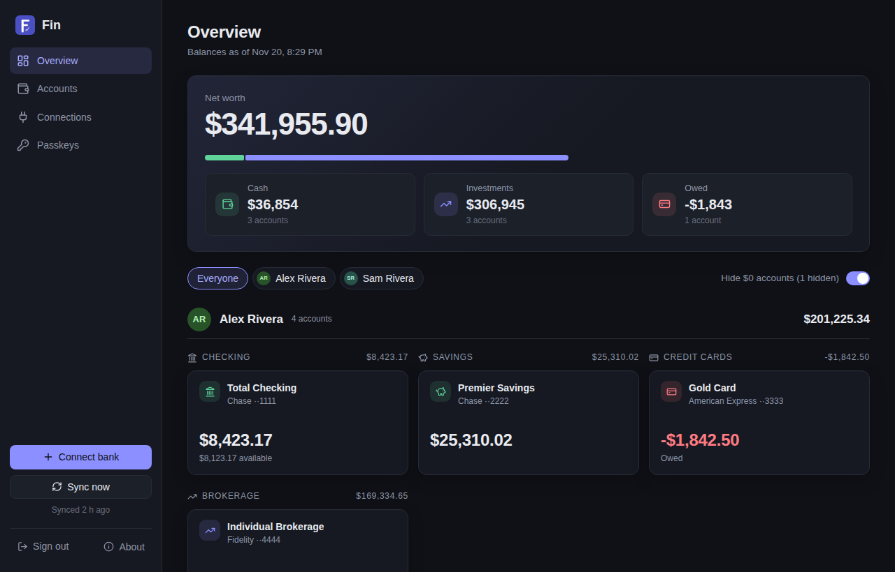
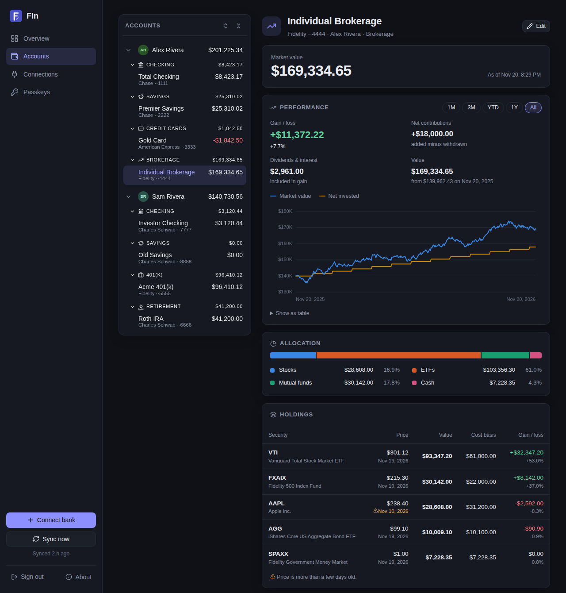
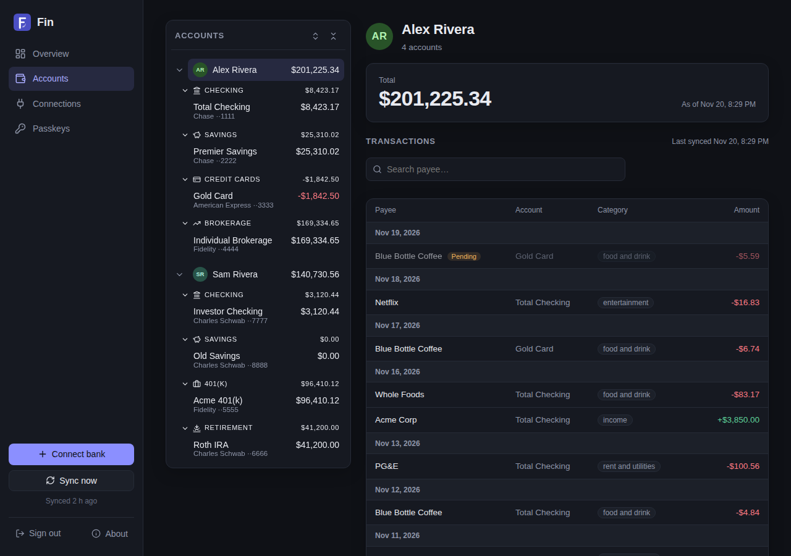
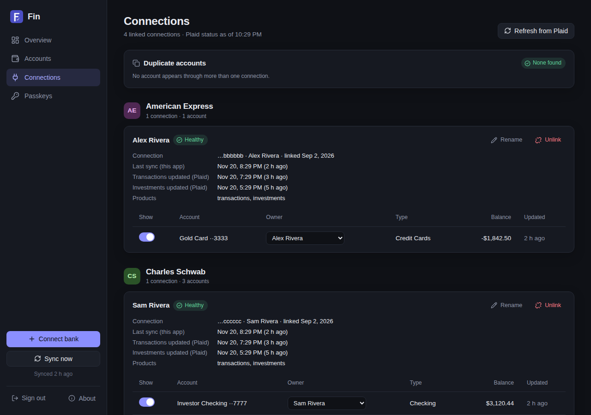
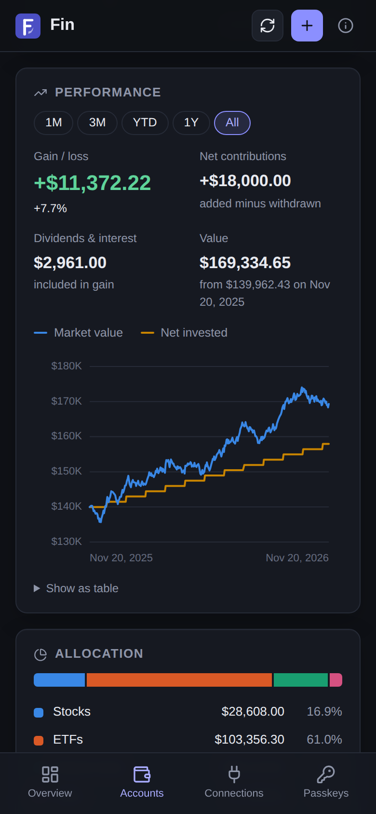

# Fin

A small, read-only dashboard of account balances, transactions and investments across a family's banks, backed by
[Plaid](https://plaid.com). Self-hosted, one instance per family, signed in with passkeys.

## Features
- **Overview:** net worth, split into cash, investments and owed, with a card per account grouped by owner and account type.
- **Transactions:** a searchable register (payee typeahead, newest first, loads as you scroll) per account or per owner.
- **Investments:** brokerage, retirement and 401(k) accounts show their market value, an allocation by asset class,
  and a holdings table (quantity, price with a stale-price flag, value, cost basis, gain/loss).
- **Performance:** each investment account's gain or loss for 1M, 3M, YTD, 1Y or all of its history. Deposits,
  withdrawals and retirement contributions are taken out, so only market moves, dividends and fees count. A chart
  plots market value against net invested, with a hover readout and a table view.
- **Connections:** health of every linked bank login, Plaid's own status, per-account owner and show/hide, detection of
  the same account linked through two logins, rename and unlink.
- **Daily sync** (plus **Sync now**): balances, transactions, investment activity and holdings. Each sync also saves a
  snapshot of every balance and position. Plaid has no history, so value-over-time and performance start at the first sync.
- **Passkey sign-in:** no passwords and no user accounts. Add devices with one-time invite links.
- Works on phones: the sidebar becomes a top bar and bottom tabs.

## Screenshots
Sample data only.

**Overview**



**Investment account: performance, allocation and holdings**



**An owner's transactions**



**Connections**



**On a phone**



## Pages
Every signed-in page shares one frame: a sidebar with the pages, **Connect bank**, **Sync now**, sign out and About (a top bar and bottom tabs on phones).

| URL | What it shows |
|---|---|
| `/` | Overview: net worth, cash / investments / owed, and a card per account grouped by owner and type (filter by owner, hide $0 accounts) |
| `/accounts` | Account list (owners → account types → accounts) beside the selection. An account shows its balance. Investment accounts add performance, allocation and holdings. Accounts with a register add transactions. An owner shows their total and all their transactions |
| `/connections` | Linked banks grouped by institution: health, last sync, Plaid status, per-account owner and show/hide, duplicate detection, rename and unlink |
| `/passkeys` | The passkeys that can sign in: add one on this device, make a one-time invite link for another device, remove one, sign out |
| `/about` | Fin's version and commit, and the versions of Node, SQLite, Plaid's API and SDK, and every package |
| `/login` | Sign in with a passkey (or create the first one) |

Investment accounts have no transaction register, except cash management accounts. Those are detected automatically
from Plaid's `cash management` subtype, or switched on per account under **Edit**, and their activity comes from Plaid
Investments.

Each account's owner is set by hand (the Owner menu on Connections, or **Edit** on the account); until then it is listed under
"Unassigned". Accounts are grouped by type automatically (overridable under **Edit**).
Credit cards and loans are shown as negative (owed) so totals add up.

## Plaid products
Link asks for **Transactions** (required) and **Investments** (consented at Link, billed by Plaid only once used). Sync
calls the Investments endpoints only for logins that have an investment account. Holdings (positions) and
Investment Transactions (activity, needed for performance) are separate Plaid subscriptions. Billing is per login
(Item); unlinking a connection in Fin ends it.

## Configuration
Copy `.env.example` to `.env` and fill it in:

| Variable | Purpose |
|---|---|
| `PLAID_CLIENT_ID`, `PLAID_SECRET`, `PLAID_ENV` | Plaid credentials (`production` for real banks, `sandbox` for testing) |
| `PLAID_REDIRECT_URI` | Required for OAuth banks (Wells Fargo, Amex, Schwab, ...). Must be `https://<your-host>/accounts` and registered under *Allowed redirect URIs* in the Plaid Dashboard |
| `SYNC_CRON`, `TZ` | When the daily sync runs (default `0 6 * * *`) and in which timezone (compose default `America/New_York`) |
| `HOSTNAMES` | Hostname(s) Caddy serves the app on (compose labels) |
| `APP_ORIGIN` | Optional. The origin passkeys are bound to (e.g. `https://fin.example.com`); defaults to the address each request arrives on |
| `DATA_DIR`, `PORT` | Database directory (default `data`, `/data` in the container) and listen port |
| `DB_KEY` | Optional. 64 hex chars (`openssl rand -hex 32`): encrypts the database (an existing plaintext one is encrypted in place on the next start). Losing it loses the data |
| `OP_TOKEN_FILE` | Compose only: host path of the 1Password service-account token (default `/etc/op/token`) |

### Secrets from 1Password
In the container, any variable whose value is a 1Password secret reference (`op://vault/item/field`) is replaced at
startup by `fin-entrypoint.sh`, so `.env` on the server holds references instead of secrets. It reads them with a
service account that can only read one dedicated vault for the server (one item per app, fields named after the
variables they replace):
1. Create a vault for the server (e.g. `my-server`) holding an item `fin` with fields `PLAID_CLIENT_ID`,
   `PLAID_SECRET` and, if you encrypt the database, `DB_KEY` (in the 1Password app, so secrets stay out of shell history).
2. Create the service account and send its token straight to the server:
   ```
   op service-account create my-server --vault my-server:read_items --raw \
     | ssh <host> 'install -D -m 400 -o 1000 -g 1000 /dev/stdin /etc/op/token'
   ```
3. In the server's `.env`, set `PLAID_CLIENT_ID=op://my-server/fin/PLAID_CLIENT_ID`, `PLAID_SECRET=op://my-server/fin/PLAID_SECRET`
   and `DB_KEY=op://my-server/fin/DB_KEY`, as in `.env.example`.
The token file is owned by uid 1000 because the container runs as `node`. The token is printed only once; if it is
lost, create a new service account (and delete the old one in 1Password). Startup fails (after a 60 s pause, to stay
within 1Password's rate limits) if a reference can't be read. Without 1Password, put plain values in `.env` and set
`OP_TOKEN_FILE=/dev/null`.

## Run
```
FIN_COMMIT=$(git rev-parse --short=10 HEAD) docker compose up -d --build   # app on 3000 in the container; the commit shows on /about
pnpm install && pnpm build       # build the web app into dist/web (the server serves it)
pnpm dev                         # local server (Node >= 26); pnpm dev:web alongside it for live reload on :5173
pnpm test                        # logic, API, passkey auth and sync tests (Plaid stubbed)
pnpm typecheck
```
The compose file follows a Caddy-docker-proxy pattern: no published ports, and the container joins the external `apps` network
so Caddy can route to it from labels. Adjust `docker-compose.yml` if you front it differently.

The daily sync runs inside the server process, so run a single instance. **Sync now** in the sidebar forces one.

## Data and security
- State lives in SQLite at `$DATA_DIR/fin.db` (`./data`, bind-mounted, in compose), including Plaid access tokens. Set `DB_KEY` to encrypt it at rest (keep the key in 1Password, not next to the database), and back it up.
- Sign-in is by passkey. There are no user accounts: every passkey on `/passkeys` can see everything.
  - **First run:** until a passkey exists, whoever opens the app can create one, so do that right after deploying. After that, new passkeys need a signed-in browser or a one-time invite link (valid 24 hours).
  - Passkeys are tied to the hostname. If the app moves to a new host, everyone re-enrolls.
  - The last passkey can't be removed (that would reopen first-run setup).
- Plaid credentials can live in 1Password instead of `.env` (above). Revoking the service account cuts off the server
  without rotating the Plaid secret.
- Keep restricting access at the network layer too (internal hostname, VPN, Twingate, ...).
- Unlinking a connection revokes it at Plaid (ending billing) and deletes its data here.

## Layout
```
src/app.ts            Express app: serves the web app for each page address, static files, routers
src/server.ts         Entry point: the daily sync cron, then listen
src/auth.ts           Sessions and the login guard in front of every page and API
src/routes/           auth (passkeys), link (Plaid Link + sync), accounts, register (transactions/payees),
                      holdings (holdings + performance), connections, about
src/db.ts             SQLite schema, additive migrations, the account_view (effective owner, register)
src/sync.ts           Per-connection sync: balances, transactions, investment activity, holdings, daily snapshots
src/performance.ts    Gain/loss and return per period, net of money moved in or out; value vs net invested
src/dto.ts            Account JSON for the web app (signed balance, kind, group)
src/classify.ts       Account grouping and order, asset classes, signed balances
src/duplicates.ts     Same account seen through several connections
src/plaid.ts          Plaid client (environment, API version) and error helper
src/plaidStatus.ts    Cached /item/get status for the Connections page
src/dates.ts, http.ts, paths.ts   Small shared helpers: dates, JSON errors, file locations
scripts/build-info.ts Records version, commit and package versions at build time for the About page
web/                  The browser app: Svelte 5 + Vite, its own pnpm workspace package (built into dist/web)
web/src/pages/        One component per page (Overview, Accounts, Connections, Passkeys, About, Login)
web/src/components/   The app frame (sidebar / phone tabs), page header, dialogs, pills, avatars; accounts/ has the
                      account list, transaction register, performance and holdings
web/src/lib/          API client, client-side router, shared account data, sync and Plaid Link state, formatting
test/                 node:test suites (pure logic, API, passkey auth with a software authenticator, sync with Plaid stubbed)
docs/screenshots/     README images, taken from sample data
```
`pnpm typecheck` checks the server (`tsconfig.json`, TypeScript 7) and the web app (`svelte-check`, which needs TypeScript 6, so `web/` pins its own).
